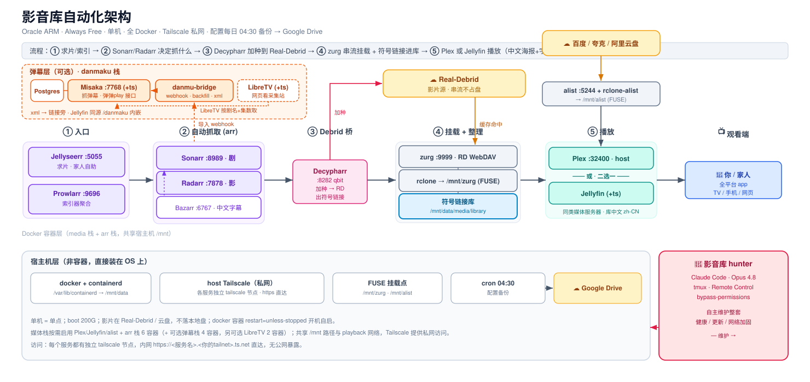

# media-stack-setup

A [Claude Code](https://docs.claude.com/en/docs/claude-code) **skill** + setup
guide for self-hosting a **streaming media library** on a single Linux box — where
media is streamed from remote storage with a local VFS cache.

Real-Debrid holds the files; `zurg` + `rclone` stream them through a FUSE mount;
the *arr stack automates acquisition; Plex/Jellyfin serve playback with Chinese
metadata; everything is reachable privately over Tailscale (nothing on the public
internet); configs back up daily to Google Drive.



## The pipeline

```
求片/索引 → Sonarr/Radarr 决定抓什么 → Decypharr 加种到 Real-Debrid
  → zurg 串流挂载 /mnt/zurg → 符号链接进 library → Plex/Jellyfin 播放（中文海报+字幕）

（可选）弹幕：Sonarr/Radarr 导入完成 webhook → danmu-bridge → Misaka 按 TMDB/TVDB+季集抓弹幕
  → <视频名>.xml 写到符号链接旁 ；播放端经 Tailscale 调 Misaka 的弹弹play 接口
（可选）LibreTV 网页播放器：搜采集站在线看，服务端按剧名+集数向 Misaka 取弹幕
```

- **media stack** (`deploy/docker-compose.yml`) — zurg (RD client) → rclone FUSE mount `/mnt/zurg`; optional alist for 百度/夸克/阿里云盘; Plex and/or Jellyfin.
- **arr stack** (`deploy/docker-compose.arr.yml`) — Prowlarr, Sonarr, Radarr, Bazarr, Jellyseerr, and **Decypharr** (a qBittorrent-shim that bridges *arr to Real-Debrid and symlinks the cached files into the library).
- **danmaku (optional)** (`deploy/docker-compose.danmaku.yml`) — [Misaka danmu server](https://github.com/l429609201/misaka_danmu_server) + Postgres + `danmu-bridge` (a small Go service in this repo: Sonarr/Radarr webhooks → Misaka, backfill, writes `<video>.xml` beside each symlink); Jellyfin shows 弹幕 inside its own web player (script injected server-side, Misaka's API served on Jellyfin's own origin, so no CORS and no per-device install), and dandanplay-compatible players (SenPlayer, Hills, …) pull 弹幕 over Tailscale. Optionally **LibreTV** (web player for third-party sources, built from upstream + this repo's patch) shows Misaka's 弹幕 too, matched by title + episode.
- **access** — a Tailscale sidecar per service → `https://<svc>.<tailnet>.ts.net`.
- **safety net** — daily cron backup of all configs → Google Drive.

## Setup path

Follow this table top to bottom. Open each doc when you reach its step. Steps 1 and 2 are required; the rest are optional or ongoing.

| # | Step | Doc | Key commands / files |
|---|------|-----|----------------------|
| 0 | Clone | this file | `git clone https://github.com/s546126/media-stack-setup.git ~/media-stack-setup`; set `REPO=~/media-stack-setup` |
| 1 | Configure and deploy | [docs/1-deploy.md](docs/1-deploy.md) | `cp -rn $REPO/deploy/. /mnt/data/media/`; `.env` from `.env.example`; zurg examples; mounts; `docker compose config`; `up -d`; acceptance |
| 2 | Wire | [docs/2-wire.md](docs/2-wire.md) | Decypharr → root folders → download client → Prowlarr → Bazarr → Jellyseerr / libraries / 中文化 → test one movie |
| 3 | 弹幕 (optional) | [docs/3-danmaku.md](docs/3-danmaku.md) | build the bridge; Misaka first boot; keys into `.env`; webhooks; backfill; Jellyfin in-player; other players; LibreTV |
| 4 | Backup | [docs/4-backup.md](docs/4-backup.md) | `scripts/config-backup.sh`; restore drill; cron |
| 5 | Daily use | [docs/5-operate.md](docs/5-operate.md) | URLs; updating images; rebuild after `git pull`; manual sync / backfill |
| — | Private HTTPS names | [docs/tailscale.md](docs/tailscale.md) | linked from step 1 and step 3 |
| — | Something broke | [docs/troubleshooting.md](docs/troubleshooting.md) | linked from each step's Verify line |

Before scheduling backups (step 4), read [docs/4-backup.md](docs/4-backup.md): the script briefly stops running stack containers and needs local archive space.

## Repo map

- `deploy/` — compose files, `.env.example`, zurg and serve templates; copied as-is to `/mnt/data/media`
- `docs/` — the numbered setup guides, Tailscale and troubleshooting notes, architecture diagram
- `scripts/` — `config-backup.sh` (daily config backup)
- `jellyfin/` — `inject-danmaku.sh` (Jellyfin web 弹幕 injection)
- `danmu-bridge/` — Go source and Dockerfile for the Sonarr/Radarr → Misaka bridge
- `libretv/` — LibreTV Dockerfile and danmaku patch, pinned upstream commit (optional)
- `tests/` — template and script checks (`requirements-dev.txt`)
- `.github/workflows/` — `validate.yml` (compose, tests, ShellCheck); `images.yml` (build bridge and LibreTV images)
- `SKILL.md` — agent entry point for the Claude Code skill

## Use it as a Claude Code skill

Drop it into your skills directory and Claude will load it automatically:

```bash
git clone https://github.com/s546126/media-stack-setup.git \
  ~/.claude/skills/media-stack-setup
```

Then in Claude Code, just ask — e.g. *"帮我搭一套 Real-Debrid 影音库"* or
*"set up Sonarr/Radarr with Real-Debrid and Plex"* — and the skill triggers,
walking the Setup path above. Or read [`SKILL.md`](SKILL.md) directly as a
guide.

## Development

Run the repository checks without service credentials:

```bash
python3 -m pip install -r requirements-dev.txt
python3 -m unittest discover -s tests -v
bash -n scripts/config-backup.sh
cd danmu-bridge && go test ./...
```

CI also validates the three compose templates with Docker Compose and runs ShellCheck.
A second workflow (`images.yml`) builds the danmu-bridge and patched LibreTV
images for linux/amd64 and linux/arm64 on native runners and smoke-tests them
(build only, nothing is pushed to a registry).
These checks do not replace the target-host playback, reboot and restore drills.

## Notes

- Secrets live in `.env` (from `deploy/.env.example`) and in `zurg/config.yml`;
  values such as `<YOUR_…>` and `100.x.x.x` are placeholders — fill in your own;
  never commit real secrets.
- Built and battle-tested on an Oracle Always Free ARM instance, but works on any
  Linux host with Docker.

---

*Generated as a reusable skill from a real deployment. Not affiliated with
Real-Debrid, Plex, Jellyfin, Misaka, or the *arr / zurg / Decypharr projects.*
